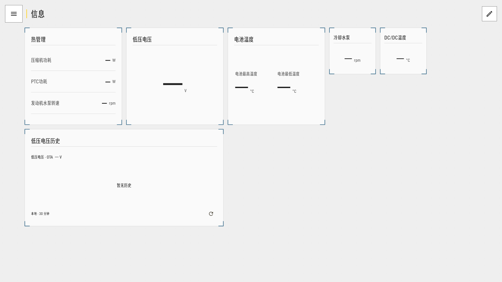
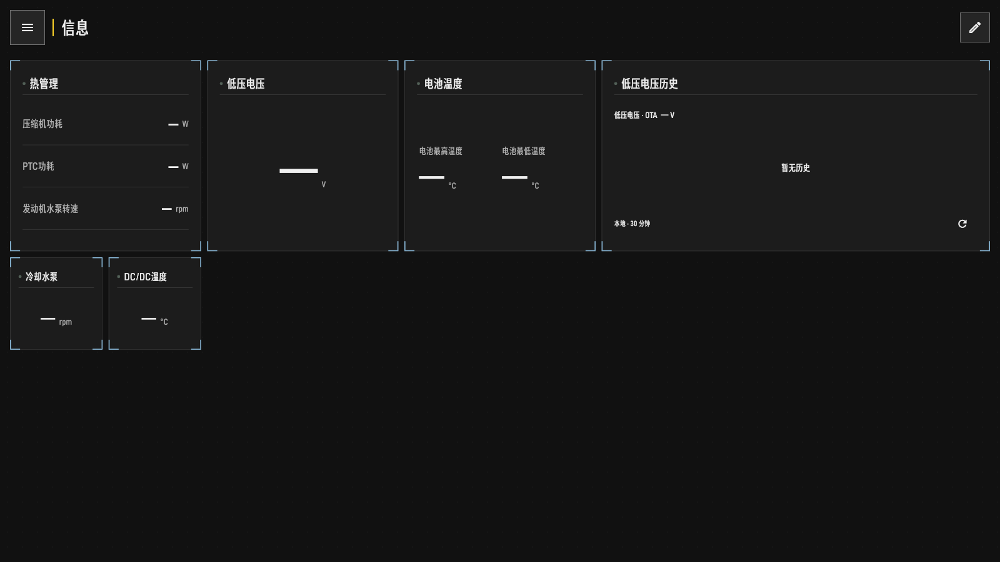

<p align="center"></p>

# SkyInfo

Android 车机信息仪表盘，用于查看原车隐藏或不便查看的数据，配置顶部悬浮条，并连接 Home Assistant 或 MQTT。

首版 **0.1.0-beta.1**，运行条件为 Android 10+、ARM64 和本机网络 ADB。车辆功能取决于设备提供的接口与权限；适配范围和验证状态见[兼容性说明](docs/验证与兼容性.md)。

## 功能

- 数值、状态、列表、设备、控制和历史曲线组件；标准／放大两档布局。
- 顶部悬浮条，自定义图标、数据、单位和位置；闲置自动锁定并点击穿透。
- Home Assistant 实体显示与控制，车辆传感器和控制实体归属同一设备。
- 高级自定义 MQTT，支持 TLS／TCP、逐字段上报和会话命令校验。
- 本地 SQLite 历史，200 MB 容量预算，与 HA 连接状态无关。
- 内置网络 ADB 授权与桥接，支持启动采集和系统浅深色主题。

离线测试中的仪表盘示例：

| 浅色 | 深色 |
| --- | --- |
|  |  |

## 安装与使用

测试 APK 的下载入口为 [GitHub Releases](https://github.com/skyboooox/SkyInfo/releases)。源码构建、签名与版本规则见[构建指南](docs/构建与发布.md)。

车机需提供本机网络 ADB 或无线调试接口。首次启动按提示完成 RSA 授权或配对，再添加仪表盘数据。HA/MQTT、悬浮显示和远程控制分别配置；配置入口与默认行为见[功能说明](docs/需求说明.md)。

## 开发

```sh
git clone --recurse-submodules https://github.com/skyboooox/SkyInfo.git
cd SkyInfo
python3 tools/check_project.py
```

Flutter 承载界面，Kotlin 承载采集、网络 ADB、悬浮条、历史和通信。检查命令见[构建指南](docs/构建与发布.md)，UI/UX 遵循固定版本的 [Fluorite Design](docs/design/fluorite-design/DESIGN.md)。

| 目录 | 内容 |
| --- | --- |
| `app/` | Flutter/Android 工程、匿名测试与视觉基线 |
| `tools/` | 构建、资源生成与源码检查 |
| `docs/` | 功能、架构、接口、兼容性和构建说明 |
| `design-assets/` | 图标、品牌矢量与来源清单 |
| `docs/design/fluorite-design/` | 固定版本的设计规范子模块 |

参见[文档导航](docs/README.md)、[贡献指南](CONTRIBUTING.md)、[隐私说明](docs/隐私与数据.md)和[第三方许可](THIRD_PARTY_NOTICES.md)。SkyInfo 是独立项目，与车辆厂商无隶属关系。

自有代码与原创资源采用 [GNU GPL-3.0](LICENSE)（SPDX: GPL-3.0-only）；第三方代码与资源遵循各自许可。
