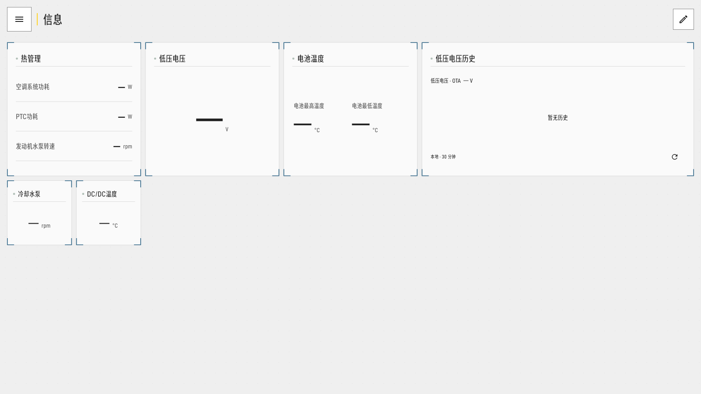
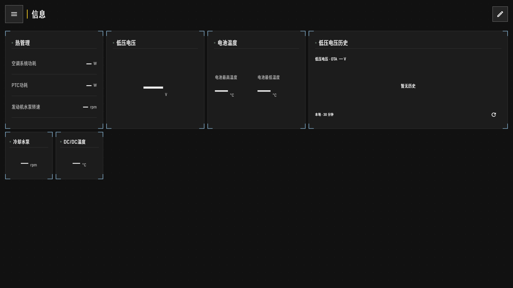

# SkyInfo

Android 车机信息仪表盘，用于查看车辆数据、配置顶部悬浮条，并连接 Home Assistant 或 MQTT。运行条件为 Android 10+、ARM64 和本机网络 ADB；车型、接口与已验证范围见[兼容性说明](docs/验证与兼容性.md)。

- 自定义信息、控制和本地历史组件，支持标准／放大布局。
- 顶部悬浮条，可配置图标、字段、精度与位置，闲置锁定并点击穿透。
- 自定义分屏、应用组合及启动页面。
- Home Assistant 实体接入、车辆上报与远控，高级自定义 MQTT。

匿名离线示例：

| 浅色 | 深色 |
| --- | --- |
|  |  |

## 安装与文档

从 [GitHub Releases](https://github.com/skyboooox/SkyInfo/releases) 下载测试 APK。首次启动完成[网络 ADB 授权](docs/网络ADB授权.md)，再添加数据；HA/MQTT、悬浮显示和远控分别配置，默认行为见[功能说明](docs/需求说明.md)。

| 内容 | 入口 |
| --- | --- |
| 组件、历史与悬浮条 | [操作流程](docs/组件添加与数据选择.md) · [样式与记录规则](docs/信息组件与历史.md) |
| 自定义分屏 | [组合、应用与启动页面](docs/自定义分屏.md) |
| Home Assistant / MQTT | [HA 实体接入](docs/HA实体接入.md) · [车辆发现与控制](docs/HA控制.md) · [MQTT 协议](docs/MQTT控制.md) |
| 车辆字段与适配 | [字段清单](docs/MQTT数据分类.md) · [转换与单位](docs/字段转换与单位.md) · [适配机制](docs/车辆数据适配.md) |
| 兼容、隐私与安全 | [验证边界](docs/验证与兼容性.md) · [隐私与数据](docs/隐私与数据.md) · [安全报告](SECURITY.md) |
| 开发与发布 | [构建、签名与发布](docs/构建与发布.md) · [架构](docs/架构.md) · [工具](tools/README.md) · [贡献指南](CONTRIBUTING.md) |
| UI/UX 与资源 | [宿主设计](DESIGN.md) · [Fluorite](docs/design/fluorite-design/DESIGN.md) · [Figma](docs/Figma设计.md) · [图标](design-assets/icons/README.md) · [启动器](design-assets/app-icon/README.md) |

Flutter/Android 工程及匿名测试在 `app/`，维护工具在 `tools/`，设计源与来源清单在 `design-assets/`。固定 Fluorite 子模块位于 `docs/design/fluorite-design/`。

自有代码与原创资源采用 [GNU GPL-3.0](LICENSE)（SPDX: GPL-3.0-only）；[第三方材料](THIRD_PARTY_NOTICES.md)遵循各自许可。SkyInfo 是独立项目，与车辆厂商无隶属关系。
